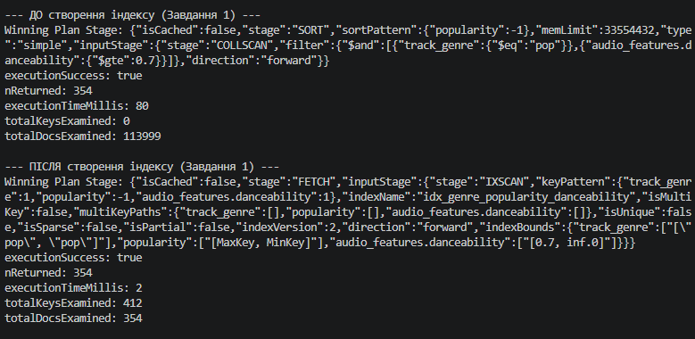

# Аналітична платформа для музичного стрімінгового сервісу (MongoDB)

Практичне завдання з проєктування документоорієнтованої схеми даних, написання аналітичних запитів, побудови Aggregation Pipelines та оптимізації запитів за допомогою індексів у **MongoDB Atlas**.

---

## Структура репозиторію

```text
.
├── .env                        # Рядок підключення MONGO_URI (не комітити!)
├── .gitignore                  # Виключення секретів, CSV-файлів та оточення
├── requirements.txt            # Python-залежності
├── scripts/
│   ├── 01_load_data.py         # Завантаження CSV → колекція tracks_raw
│   └── 02_transform.js         # Трансформація tracks_raw → колекція tracks (MQL)
├── queries/
│   ├── part2_queries.js        # Аналітичні запити та пайплайни (Частина 2)
│   └── part3_indexes.js        # Індекси та профілювання explain() (Частина 3)
└── README.md                   # Документація, схема та відповіді на питання
```

---

## Налаштування оточення та запуск проєкту

### 1. Встановлення Python-залежностей
Створіть та активуйте віртуальне середовище, після чого встановіть необхідні бібліотеки:
```bash
python -m venv venv
# Windows (PowerShell):
.\venv\Scripts\Activate.ps1
# Linux / macOS:
source venv/bin/activate

pip install -r requirements.txt
```

### 2. Налаштування змінних середовища (`.env`)
У корені проєкту створіть файл `.env` і додайте рядок підключення до вашого кластера [MongoDB Atlas](https://www.mongodb.com/atlas):
```env
MONGO_URI=mongodb+srv://<user>:<password>@<cluster>.mongodb.net/
```

### 3. Завантаження датасету
Завантажте датасет **Spotify Tracks Dataset** (`dataset.csv`, ~114 000 треків) із Kaggle та помістіть файл `dataset.csv` у кореневу папку репозиторію.

### 4. Порядок запуску скриптів
1. **Завантаження сирих даних у `spotify.tracks_raw`:**
   ```bash
   python scripts/01_load_data.py
   ```
2. **Трансформація у документоорієнтовану колекцію `spotify.tracks`:**
   ```bash
   mongosh "mongodb+srv://<user>:<password>@<cluster>.mongodb.net/" --file scripts/02_transform.js
   ```
3. **Виконання аналітичних запитів (Частина 2):**
   ```bash
   mongosh "mongodb+srv://<user>:<password>@<cluster>.mongodb.net/" --file queries/part2_queries.js
   ```
4. **Створення індексів та перевірка `explain()` (Частина 3):**
   ```bash
   mongosh "mongodb+srv://<user>:<password>@<cluster>.mongodb.net/" --file queries/part3_indexes.js
   ```

---

## Схема даних колекції `tracks`

Після виконання скрипта `scripts/02_transform.js` кожен документ у колекції `spotify.tracks` має таку структуру:

* `track_id` (`String`) — унікальний ідентифікатор треку Spotify.
* `track_name` (`String`) — назва треку.
* `album_name` (`String`) — назва альбому.
* `artists` (`Array<String>`) — масив виконавців, розбитий із сирого рядка за роздільником `;` та очищений від зайвих пробілів.
* `explicit` (`Boolean`) — наявність ненормативної лексики.
* `popularity` (`Int32`) — показник популярності треку (`0–100`).
* `popularity_tier` (`String`) — обчислювана категорія популярності (`"high"` при $\ge 70$, `"medium"` при $40\text{–}69$, `"low"` при $< 40$).
* `duration_ms` (`Int32`) — тривалість треку в мілісекундах.
* `duration_sec` (`Double`) — обчислювана тривалість треку в секундах, округлена до 1 знака після коми.
* `track_genre` (`String`) — музичний жанр треку.
* `audio_features` (`Object`) — вкладений піддокумент із 12 числовими акустичними характеристиками (`danceability`, `energy`, `loudness`, `speechiness`, `acousticness`, `instrumentalness`, `liveness`, `valence`, `tempo`, `key`, `mode`, `time_signature`).

### Приклад документа в JSON:
```json
{
  "_id": "674000000000000000000001",
  "track_id": "5SuOfxsvuAmcJbH553314",
  "track_name": "Comedy",
  "album_name": "Comedy",
  "artists": ["Gen Hoshino"],
  "explicit": false,
  "popularity": 73,
  "popularity_tier": "high",
  "duration_ms": 230666,
  "duration_sec": 230.7,
  "track_genre": "acoustic",
  "audio_features": {
    "danceability": 0.676,
    "energy": 0.461,
    "loudness": -6.746,
    "speechiness": 0.143,
    "acousticness": 0.0322,
    "instrumentalness": 0.00000101,
    "liveness": 0.358,
    "valence": 0.715,
    "tempo": 87.917,
    "key": 1,
    "mode": 0,
    "time_signature": 4
  }
}
```

---

## Частина 1 — Відповіді на теоретичні питання

### 1. Чому аудіо-характеристики винесені в окремий об’єкт `audio_features`, а не зберігаються плоско? Коли таке вкладення вигідне, а коли створює проблеми?

**Чому використано вкладений об’єкт:**
У колекції `tracks` документ поєднує два різні за призначенням рівні інформації: бізнес-метадані треку (`track_id`, `track_name`, `album_name`, `artists`, `popularity`, `popularity_tier`, `explicit`, `track_genre`) та низькорівневі акустичні метрики (`danceability`, `energy`, `tempo`, `loudness`, `valence` тощо). Групування 12 числових характеристик у вкладений піддокумент `audio_features` логічно структурує схему, робить її читабельною та відокремлює каталожну інформацію від аналітичних параметрів звуку.

**Коли таке вкладення вигідне:**
* **Зручність проєкцій (Projection):** Коли для інтерфейсу застосунку або списку треків потрібні лише базові метадані, достатньо виключити один блок (`{ audio_features: 0 }`), замість переліку 12 окремих полів. Аналогічно, для ML-моделей чи рекомендаційних систем можна одним полем отримати весь вектор фіч (`{ audio_features: 1 }`).
* **Атомарність оновлення профілю характеристик:** При оновленні версії алгоритму аналізу аудіо весь об’єкт `audio_features` можна перезаписати однією операцією `$set` без ризику змінити метадані релізу.
* **Логічна інкапсуляція:** Схема стає самодокументованою — одразу видно різницю між описом треку та його акустичними властивостями.

**Коли вкладення створює проблеми:**
* **Складніші індекси та синтаксис запитів:** Для фільтрації або сортування за внутрішніми ключами доводиться використовувати точкову нотацію (`"audio_features.tempo"`, `"audio_features.danceability"`), а також створювати індекси на конкретні вкладені шляхи (наприклад, `{ track_genre: 1, popularity: -1, "audio_features.danceability": 1 }`).
* **Надлишкова передача даних при вибірці всього об'єкта:** Якщо запиту потрібен лише один параметр (наприклад, `tempo`), але в проєкції вказано весь об'єкт `audio_features`, MongoDB передаватиме всі 12 полів.
* **Надмірна глибина вкладеності:** За умови 3+ рівнів вкладеності ускладнюються агрегації, оновлення окремих ключів і серіалізація в клієнтському коді.

---

### 2. Чому виконавці зберігаються як масив, а не як рядок? Які запити стають простішими?

**Чому масив (`artists: ["Drake", "Future"]`), а не рядок (`"Drake; Future"`):**
У сирому CSV-файлі кілька виконавців записані в одному рядку через роздільник `;`. У документоорієнтованій моделі такий рядок є неатомарним і не дозволяє базі даних працювати з кожним артистом окремо без текстового парсингу. Перетворення рядка на масив під час трансформації (`$split` + `$trim`) робить кожного виконавця окремим елементом даних.

**Які запити стають простішими та ефективнішими:**
* **Пошук усіх треків конкретного артиста (включно з колабораціями):** Замість повільного пошуку підрядка регулярними виразами (`{ artists: /Future/ }`), який погано використовує індекси й може давати хибні збіги за частиною імені, виконується точний пошук по масиву: `db.tracks.find({ artists: "Future" })`.
* **Використання Multikey-індексів:** MongoDB автоматично індексує кожен елемент масиву `artists`, що забезпечує швидкий пошук за будь-яким співавтором треку.
* **Аналітика та групування по кожному артисту:** За допомогою стадії `$unwind: "$artists"` в Aggregation Pipeline можна розгорнути колаборації та обчислити кількість треків, мінімальну й середню популярність для кожного виконавця окремо (як у Завданні 2 Частини 2).
* **Фільтрація за складом виконавців:** Можна використовувати нативні оператори масивів — наприклад, пошук дуетів через `{ artists: { $size: 2 } }` або пошук спільних треків конкретних артистів через `{ artists: { $all: ["Drake", "Future"] } }`.

---

## Частина 2 — Логіка аналітичних запитів (`queries/part2_queries.js`)

1. **Завдання 1 (Треки для вечірки):** Використано комбінацію діапазонних операторів `$gt` та `$gte`/`$lte` по вкладених полях `"audio_features.danceability"`, `"audio_features.energy"` і полю `duration_ms` (`180000–300000` мс) із сортуванням за `popularity: -1`.
2. **Завдання 2 (Виконавці, у яких усі треки популярні):** Використано `$unwind: "$artists"` для розгортання колаборацій, `$group` для підрахунку `track_count`, `min_popularity` та `avg_popularity`, після чого `$match` фільтрує артистів із `track_count >= 3` та `min_popularity >= 60`.
3. **Завдання 3 (Нетипові треки за темпом у межах жанру):** Групування за `track_genre` обчислює середній темп (`$avg`) та стандартне відхилення генеральної сукупності (`$stdDevPop`). Порогове значення обчислюється як `avg_tempo + 2 * std_tempo`, після чого оператор `$filter` у стадії `$project` відбирає лише треки-викиди (`tempo > outlier_threshold`).
4. **Завдання 4 (Треки для фонової роботи):** Фільтрація поєднує точну перевірку `explicit: false` та діапазонні умови для `loudness` (`< -10`), `speechiness` (`< 0.1`) та `instrumentalness` (`> 0.5`).

---

## Частина 3 — Індекси та оптимізація (`queries/part3_indexes.js`)

### Завдання 1. Аналіз запиту та складений індекс (правило ESR)

Запит:
```javascript
db.tracks.find({
  track_genre: "pop",
  "audio_features.danceability": { $gte: 0.7 }
}).sort({ popularity: -1 });
```

Створений складений індекс (за принципом **Equality → Sort → Range**):
```javascript
db.tracks.createIndex({
  track_genre: 1,
  popularity: -1,
  "audio_features.danceability": 1
});
```

#### Порівняння метрик `explain("executionStats")`

| Метрика | ДО створення індексу | ПІСЛЯ створення індексу |
| :--- | :--- | :--- |
| **Winning Plan Stage** | `COLLSCAN` + `SORT` (в пам'яті) | `FETCH` ← `IXSCAN` |
| **`nReturned`** | `354` | `354` |
| **`totalDocsExamined`** | `~114 000` (уся колекція) | `354` (рівне `nReturned`) |
| **`totalKeysExamined`** | `0` | `412` |
| **`executionTimeMillis`** | `80` мс | `2` мс |



**Що змінилося в плані виконання та як зрозуміти, що індекс працює:**
1. **Зник повний перебір колекції (`COLLSCAN` → `IXSCAN`):** До індексації MongoDB зчитувала всі ~114 000 документів із диска (`totalDocsExamined` дорівнював загальній кількості документів, а `totalKeysExamined: 0`). Після створення індексу планувальник перейшов на сканування B-tree індексу (`IXSCAN`), і значення `totalKeysExamined` стало додатним, а `totalDocsExamined` скоротилося лише до кількості реально повернутих документів (`nReturned`).
2. **Зникла окрема стадія сортування в пам'яті (`SORT`):** Оскільки поле `popularity: -1` розташоване в індексі одразу після `track_genre: 1` (згідно з правилом ESR), записи з індексу зчитуються вже у потрібному порядку спадання популярності. Це усуває витрати оперативної пам'яті та ліміт у 100 МБ на in-memory сортування.

---

### Завдання 2. Індекс для треків для фонової роботи

Створений складений індекс (точний збіг `explicit` першим, далі діапазонні поля):
```javascript
db.tracks.createIndex({
  explicit: 1,
  "audio_features.instrumentalness": 1,
  "audio_features.speechiness": 1
});
```

* **До індексу:** `stage: "COLLSCAN"`, `totalDocsExamined: ~114 000`, `totalKeysExamined: 0`, `executionTimeMillis: <вставте_значення>` мс.
* **Після індексу:** `stage: "IXSCAN"`, `totalDocsExamined: <вставте_значення>`, `totalKeysExamined: <вставте_значення>`, `executionTimeMillis: <вставте_значення>` мс.

---

### Завдання 3. Чи є запит покривним (Covered Query)?

Дано запит (за наявності індексу `{ track_genre: 1, popularity: -1, "audio_features.danceability": 1 }`):
```javascript
db.tracks.find({
  track_genre: "pop",
  popularity: { $gte: 70 }
});
```

**Відповідь: Ні, цей запит НЕ є покривним (Covered Query).**

**Обґрунтування:**
У MongoDB запит вважається покривним (`totalDocsExamined: 0`), коли **усі** поля у фільтрі запиту та **усі** поля, що повертаються в результаті, містяться в одному індексі, і базі даних не потрібно звертатися до самих документів колекції (відсутня стадія `FETCH`). У наведеному запиті порушено дві обов'язкові умови:
1. **Відсутня проєкція (Projection):** Запит не містить другого аргументу з проєкцією полів, тому MongoDB за замовчуванням повертає **увесь документ цілком** (`track_name`, `artists`, `album_name`, `audio_features` тощо). Оскільки цих полів немає в індексі, MongoDB змушена виконати стадію `FETCH` і вичитати кожен знайдений документ із колекції (`totalDocsExamined > 0`).
2. **Поле `_id` не виключене:** Навіть якби проєкція обмежувалася лише полями `track_genre` та `popularity`, поле `_id` повертається за замовчуванням і не входить до складеного індексу — його обов'язково потрібно явно виключити (`_id: 0`).

**Як зробити цей запит покривним:**
```javascript
db.tracks.find(
  { track_genre: "pop", popularity: { $gte: 70 } },
  { _id: 0, track_genre: 1, popularity: 1 }
);
```
У такому вигляді `explain("executionStats")` покаже `totalDocsExamined: 0` та план виконання `PROJECTION_COVERED` ← `IXSCAN`.
